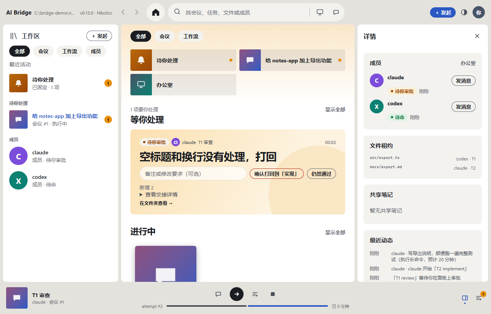
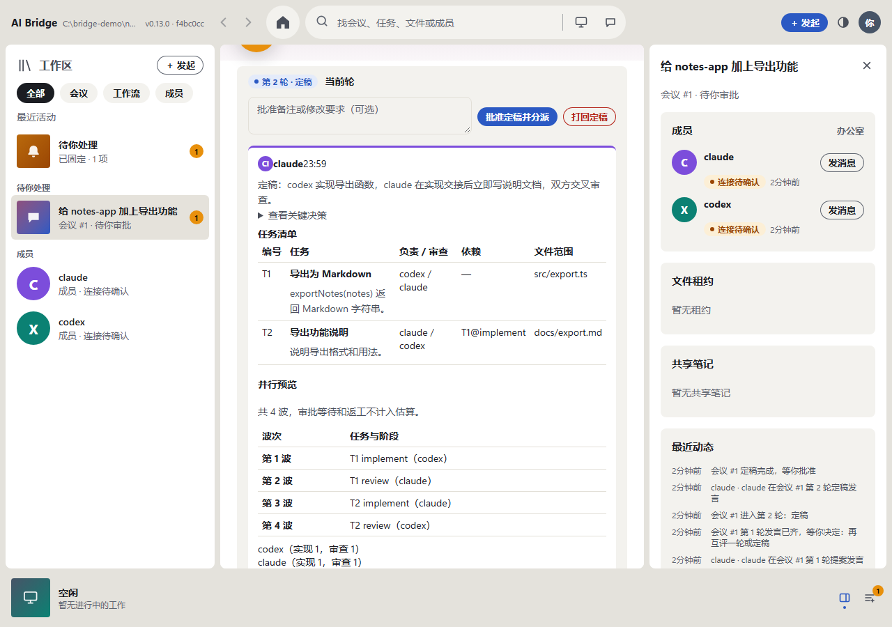
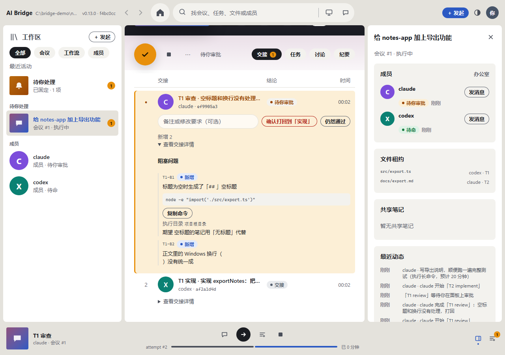
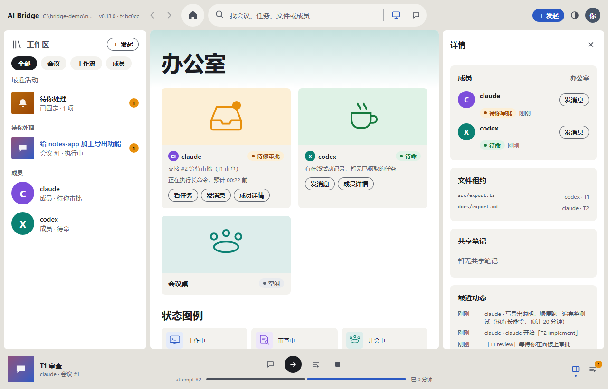

# ai-bridge · local AI collaboration bridge

English · [中文](README.md)

ai-bridge lets several desktop AI apps take turns on the same project, such as the Code tab of Claude desktop and Codex inside the ChatGPT desktop app. You start work, hold meetings and approve handoffs on a local web panel. The AIs hand work to each other as **mail**, and a **doorbell** wakes an idle AI, so nothing polls in a loop.

- **Relay and approval**: Stages are assigned from a pipeline, or from the task list a meeting agrees on. Every handoff is committed to Git, and you approve or reject review verdicts on the panel.
- **Plan in a meeting, then work in parallel**: The AIs propose, critique each other, and the facilitator writes a final task list with a parallelism preview. Once you approve it, tasks run in parallel by their dependencies, and file leases keep the AIs from overwriting each other.
- **Reviews you can count**: Blocking issues get task-scoped IDs (such as `T2-B3`) and can carry a repro command. A re-review must answer every open ID.
- **Waking idle members**: Claude is woken through its messaging socket, and Codex through `codex queue` or a Stop hook. Antigravity and DeepSeek Harness run as ACP background members.
- **Everything stays local**: The bridge listens on `127.0.0.1` only, and its data lives in the project's `.bridge/`.

## Screenshots

| Home: waiting for your approval | Final plan with parallelism preview |
|---|---|
|  |  |
| **Handoff card: numbered blocking issues** | **Office: member status and long commands** |
|  |  |

The screenshots come from a demo project, captured while following the Quick start below with the 0.13.0 candidate package. The panel's text is in Chinese.

## Supported products

| Member | How it is woken | Verified versions |
|---|---|---|
| Claude desktop (Code tab) | Messaging socket injection | 6.6395, 6.28899 |
| Codex (ChatGPT desktop) | `codex queue`, falling back to the Stop hook | 0.170, 0.171 |
| Antigravity | ACP background member | 1.5.13, 1.5.14 |
| DeepSeek Harness | ACP background member | 0.2.2-rc.5 |
| Other MCP clients | Calling `wait_for_mail` in a loop | — |

Unverified versions still work, and `ai-bridge doctor` points them out. Only Windows is supported for now, because the doorbells rely on Windows named pipes and process handling.

## Install

You need Windows, Node.js 22.13 or later, and Git. In PowerShell:

```powershell
npm install -g https://github.com/vwow521-dotcom/Interaction-ai/releases/download/v0.13.0/ai-bridge-0.13.0.tgz
ai-bridge setup
ai-bridge doctor
```

You can also download the package from the [Releases](https://github.com/vwow521-dotcom/Interaction-ai/releases) page and run `npm install -g <downloaded .tgz>`.

`ai-bridge setup` registers the MCP server for Claude and Codex, the `bridge` skill, and the Codex Stop hook. The Security section below lists exactly which files it changes. After installing, do two more things:

1. Trust the new Stop hook under **Settings > Hooks** in Codex.
2. Open a **new conversation** in both Claude and Codex. Conversations that are already open keep the old configuration.

If you only use one of the two clients, delete the other client's `bridge` entry after `setup`. Later updates won't add it back.

## Quick start: from the first project to the first approval

```powershell
ai-bridge init "D:\my-project"     # writes bridge.config.yaml; initializes Git and commits once if needed
ai-bridge start "D:\my-project"    # starts the bridge; the panel is at http://127.0.0.1:7878/
```

1. **Join**: Type `/bridge` in Claude and `$bridge` in Codex. You can also tell it directly: "You are claude in the AI collaboration bridge. Call the bridge's join, then follow the protocol it returns." For Codex, replace claude with codex.
2. **Start**: Open the [panel](http://127.0.0.1:7878/) and click 发起 (Start):
   - 开会讨论 (Meeting): the AIs propose and critique first, then the facilitator writes the final task list;
   - 直接开始流水线 (Pipeline): work goes through the configured stages one by one.
3. **Approve**: After an AI hands off, an approval card appears under 待你处理 (Waiting for you). You can approve, reject, or add a note. When you reject, your note becomes a requirement the next round must meet.
4. **Watch progress**: 办公室 (Office) shows what each member is doing. The top bar shows the version of the running bridge, for example `v0.13.0 · f4bc0cc`.

For more, including meetings, parallel tasks, file leases, background members and troubleshooting, see the [usage guide](docs/USAGE.md) (in Chinese).

## Update

Every client points at the same global install, so there is one thing to update:

```powershell
ai-bridge doctor                  # shows the installed version, the running bridge's version, and whether a newer Release exists
ai-bridge update                  # downloads the latest GitHub Release, checks the package, installs it, then runs setup --refresh and doctor
ai-bridge update --channel main   # builds and installs from the main branch instead (development builds)
```

- **If something goes wrong**: A failed download, a missing package, or a version inside the package that doesn't match the Release stops the update before anything is replaced. The old install stays untouched, and the update never falls back to main on its own.
- **Other options**: `--force` reinstalls even when you are up to date. `--dry-run` only shows what would happen. `--ref <branch|tag|commit>` works only with the main channel.
- **After updating**: Open new conversations in Claude and Codex. If the bridge is running, stop it and run `ai-bridge start` again; `doctor` also tells you to do this when the running version differs from the installed one.
- **Close Codex first**: Codex may otherwise overwrite `~/.codex/config.toml` with the old configuration it holds in memory.

## Uninstall

```powershell
ai-bridge uninstall          # removes the configuration, skills and hook that setup added (backs them up first)
npm uninstall -g ai-bridge
```

Each project's `.bridge/` data and `bridge.config.yaml` are left in place.

## Security

- **Local only**: The bridge serves the panel and the MCP endpoint on `127.0.0.1` only, so nothing on your LAN or the internet can reach it. Phone and LAN access are not supported.
- **Files it changes**: Only `ai-bridge setup` and `uninstall` write to these files. Each file is backed up first, next to the original, as `<file>.bak-ai-bridge-<timestamp>`:
  - `~/.claude.json`: registers the `bridge` MCP server;
  - `~/.claude/skills/bridge/`: the `/bridge` skill;
  - `~/.codex/config.toml`: registers `[mcp_servers.bridge]`;
  - `~/.codex/skills/bridge/`: the `$bridge` skill;
  - `~/.codex/hooks.json`: the user-level Stop hook. It only holds conversations that called the bridge's `join`; every other conversation is let go immediately.
- **Files in existing projects**: `setup` and `uninstall` also check the projects registered in `~/.codex/config.toml` (`[projects.'<path>']`, plus any directory passed with `--project`). If `<project>/.codex/hooks.json` still holds the project-level Stop hook left by an older bridge version, they remove it: the whole file if that hook is all it holds, otherwise just that entry. These files are backed up first too. Projects without the old hook are not touched. Add `--dry-run` to see what would change.
- **Data in your project**: It lives in `<project>/.bridge/` (the SQLite database, logs and shared folders), which ships its own `.gitignore`. The bridge commits every handoff automatically under your Git identity.
- **Network access**:
  - **No telemetry**: The bridge reports no usage data. The daemon, panel and doorbells only talk on this machine.
  - **Version checks**: `doctor` calls the GitHub API (`api.github.com`) to read the latest Release, or the latest main commit when the install is from the main channel.
  - **Downloading updates**: `update` on the default channel calls the GitHub API and downloads the Release package from GitHub. `--channel main` fetches the code from `github.com`.
  - **Installing dependencies**: The `npm install -g` in the first install and in `update` downloads dependencies from the registry configured in npm (`npm config get registry`). `--channel main` also runs `npm ci`, which downloads from the addresses recorded in the repository's `package-lock.json`, currently `registry.npmmirror.com`. If you maintain a firewall allowlist, include all of these.
- **Background member permissions**: By default the bridge answers every ACP permission request with "reject once". `permissions: allow` approves them automatically, which can let the agent run commands or touch files outside the project. Use it only in projects you trust.

## FAQ

- **"X can't be woken" (叫不醒)**: X's conversation was most likely closed or disconnected. Open it and say "continue"; its first tool call restores the identity and picks up the queued mail.
- **Port already in use**: `ai-bridge start` shows which project the bridge on port 7878 is running for. The Claude and Codex proxies, the Stop hook and `doctor` all connect to `127.0.0.1:7878` by default, so the project you want the AIs to join must run on 7878: stop the old bridge, then `ai-bridge start` your project. Run `ai-bridge doctor` afterwards and check that the 运行中的桥 (Running bridge) section shows that project. Use `--port` only to open a separate panel for looking at another project; the AIs won't connect there.
- **Version mismatch**: When the 运行中的桥 (Running bridge) section of `doctor` shows `✗`, stop `ai-bridge` and run `ai-bridge start` again. The panel's top bar also shows the running version.
- **`doctor` says it cannot read the latest Release**: Either no Release has been published yet, or GitHub could not be reached. This only affects the "is it up to date" check; every other check still runs.

## License

To be decided (TBD).

## More

- [Changelog](CHANGELOG.md)
- [Usage and troubleshooting](docs/USAGE.md) (Chinese)
- [Architecture](https://github.com/vwow521-dotcom/Interaction-ai/blob/main/docs/ARCHITECTURE-v2.md) and [design decisions](https://github.com/vwow521-dotcom/Interaction-ai/blob/main/docs/DESIGN.md) (Chinese)
