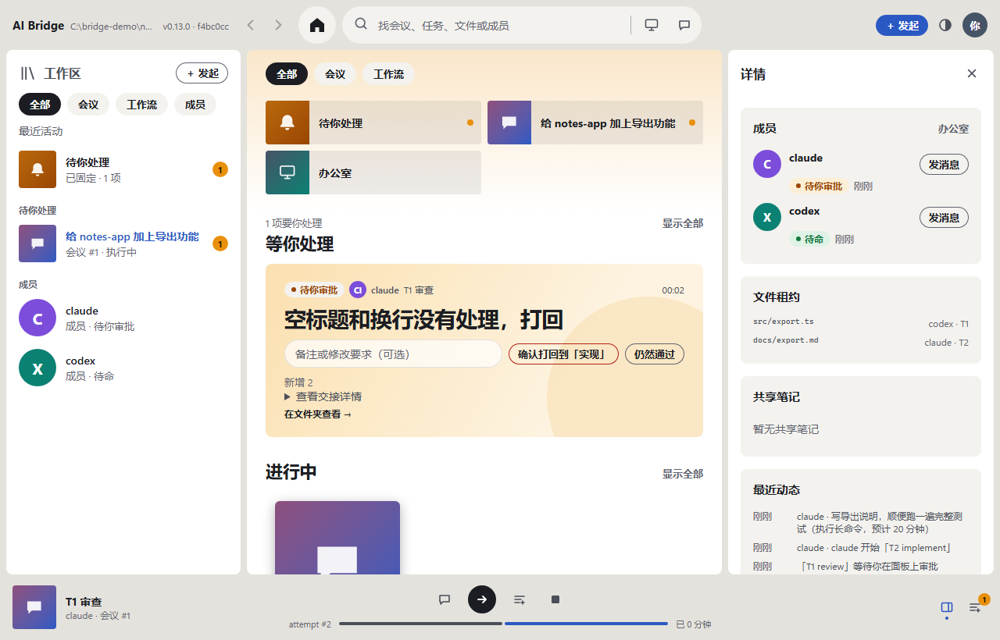
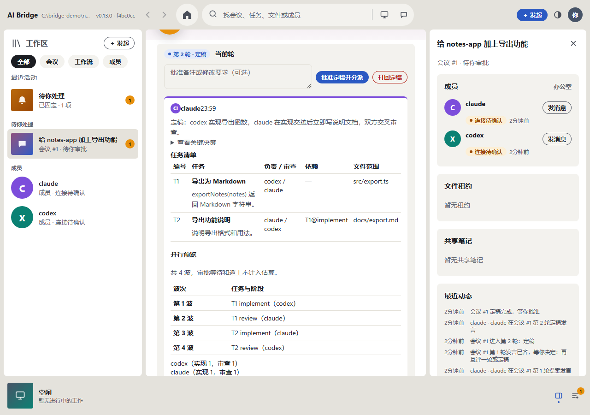
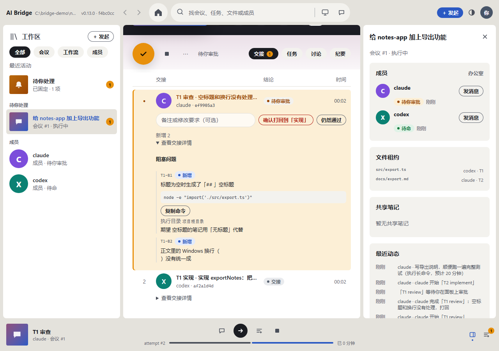
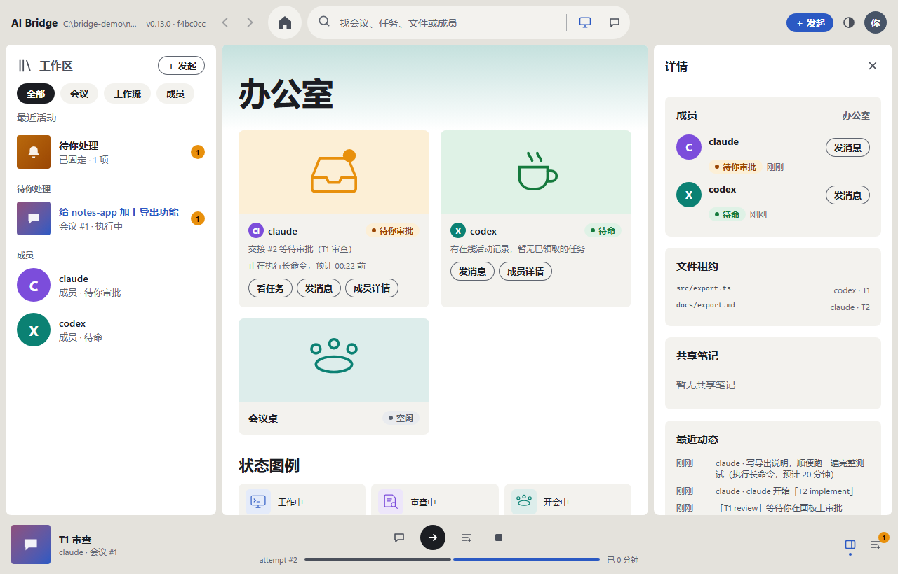

# ai-bridge · 本地 AI 协作桥

[English](README.en.md) · 中文

ai-bridge 让几款桌面端 AI 在同一个项目里接力工作，比如 Claude 桌面版的 Code 标签页、ChatGPT 桌面版里的 Codex。你在本机的网页面板上发起任务、开会、审批，AI 之间通过「信件」交接，空闲的 AI 由「门铃」叫醒，不用一直轮询。

- **接力与审批**：按流水线或会议定稿的任务清单分派阶段。每次交接自动提交 Git，审查结论需要你在面板上批准或打回。
- **开会定稿，并行开工**：各 AI 先提案、互评，再由主持人定稿任务清单，定稿时附一份并行预览。批准后按依赖并行分派，文件租约防止互相改乱。
- **可数的审查**：阻塞问题有任务内编号（如 `T2-B3`），可以附复现命令。复审必须逐条答复。
- **空闲唤醒**：Claude 通过消息套接字唤醒，Codex 通过 `codex queue` 或 Stop hook 唤醒，Antigravity 和 DeepSeek Harness 作为 ACP 后台成员运行。
- **一切在本机**：只监听 `127.0.0.1`，数据存在项目的 `.bridge/` 里。

## 截图

| 主页：待你审批 | 会议定稿与并行预览 |
|---|---|
|  |  |
| **交接卡：带编号的阻塞问题** | **办公室：成员状态与长命令** |
|  |  |

截图来自一个演示项目，用的是 0.13.0 候选安装包，按下面的「快速开始」实际操作得到。

## 支持的产品

| 成员 | 唤醒方式 | 已验证版本 |
|---|---|---|
| Claude 桌面版（Code 标签页） | 消息套接字注入 | 6.6395、6.28899 |
| Codex（ChatGPT 桌面版） | `codex queue`，失败时退回 Stop hook | 0.170、0.171 |
| Antigravity | ACP 后台成员 | 1.5.13、1.5.14 |
| DeepSeek Harness | ACP 后台成员 | 0.2.2-rc.5 |
| 其他 MCP 客户端 | 循环调用 `wait_for_mail` | — |

未验证的版本也能用，`ai-bridge doctor` 会给出提示。目前只支持 Windows，门铃依赖 Windows 上的命名管道和进程管理。

## 安装

需要 Windows 和 Node.js 22.13 或更新版本，还需要 Git。在 PowerShell 中运行：

```powershell
npm install -g https://github.com/vwow521-dotcom/Interaction-ai/releases/download/v0.13.0/ai-bridge-0.13.0.tgz
ai-bridge setup
ai-bridge doctor
```

安装包也可以先从 [Releases](https://github.com/vwow521-dotcom/Interaction-ai/releases) 页面下载，再运行 `npm install -g <下载的 .tgz>`。

`ai-bridge setup` 会注册 Claude 和 Codex 的 MCP 服务、`bridge` skill 和 Codex 的 Stop hook。具体改了哪些文件，见下文「安全说明」。装好之后还要做两件事：

1. 在 Codex 的 **Settings > Hooks** 里信任新的 Stop hook。
2. 在 Claude 和 Codex 里各**新开一个对话**，已经开着的对话还在用旧配置。

只用其中一个客户端的话，`setup` 之后删掉另一个的 `bridge` 配置即可，以后更新不会把它加回来。

## 快速开始：从第一个项目到第一次审批

```powershell
ai-bridge init "D:\my-project"     # 生成 bridge.config.yaml；不是 Git 仓库就初始化并提交一次
ai-bridge start "D:\my-project"    # 启动协作桥，面板在 http://127.0.0.1:7878/
```

1. **加入**：在 Claude 里输入 `/bridge`，在 Codex 里输入 `$bridge`。也可以直接对它说：「你是 AI 协作桥中的 claude。调用 bridge 的 join，然后按返回的 protocol 工作。」对 Codex 说的时候，把 claude 换成 codex。
2. **发起**：打开[面板](http://127.0.0.1:7878/)，点「发起」：
   - 「开会讨论」：先让各个 AI 提案、互评，再定稿出任务清单；
   - 「直接开始流水线」：按配置的阶段一步步做。
3. **审批**：AI 交接后，面板的「待你处理」会出现审批卡。你可以批准、打回，或者写一句要求。打回时你的备注会成为下一轮必须完成的要求。
4. **看进度**：「办公室」显示每个成员在做什么。顶栏显示正在运行的桥的版本，例如 `v0.13.0 · f4bc0cc`。

更多用法见[使用说明](docs/USAGE.md)：会议、并行任务、文件租约、后台成员、故障排查。

## 更新

所有客户端都指向同一个全局安装，只需要更新这一处：

```powershell
ai-bridge doctor                  # 列出安装的版本、正在运行的桥的版本，以及是否落后于最新 Release
ai-bridge update                  # 下载最新的 GitHub Release，核对安装包后再全局安装，然后 setup --refresh 和 doctor
ai-bridge update --channel main   # 改为从 main 分支构建安装（开发版）
```

- **出错时**：下载失败、找不到安装包、或包内的版本与 Release 对不上，都会在替换之前停下，旧安装不受影响，也不会自动改用 main。
- **其他选项**：`--force` 即使已是最新也重装，`--dry-run` 只显示会做什么，`--ref <分支|标签|提交>` 只用于 main 通道。
- **更新之后**：在 Claude 和 Codex 里新开对话。如果桥正在运行，停掉后重新 `ai-bridge start`；`doctor` 发现运行中的版本和安装的版本不一致时，也会提示这一步。
- **关掉 Codex 再更新**：最好先关掉 Codex 再运行 `update`，否则 Codex 可能用它内存里的旧配置覆盖 `~/.codex/config.toml`。

## 卸载

```powershell
ai-bridge uninstall          # 移除 setup 添加的配置、skill 和 hook（先备份）
npm uninstall -g ai-bridge
```

各项目里的 `.bridge/` 数据和 `bridge.config.yaml` 不会被删除。

## 安全说明

- **只监听本机**：协作桥只在 `127.0.0.1` 上提供面板和 MCP 服务，局域网和外网都访问不到。手机和局域网访问暂不支持。
- **会修改的文件**：只有 `ai-bridge setup` 和 `uninstall` 会写入以下文件，每改一个都先在原位置备份为 `<文件名>.bak-ai-bridge-<时间戳>`：
  - `~/.claude.json`：注册 `bridge` MCP 服务；
  - `~/.claude/skills/bridge/`：`/bridge` skill；
  - `~/.codex/config.toml`：注册 `[mcp_servers.bridge]`；
  - `~/.codex/skills/bridge/`：`$bridge` skill；
  - `~/.codex/hooks.json`：用户级 Stop hook。它只拦下调用过 bridge `join` 的对话，其他对话结束时立即放行。
- **已有项目里的文件**：`setup` 和 `uninstall` 还会检查 `~/.codex/config.toml` 里登记过的项目（`[projects.'<路径>']`，以及用 `--project` 指定的目录）。如果 `<项目>/.codex/hooks.json` 里有旧版协作桥留下的项目级 Stop hook，就把它删掉：文件里只剩这个 hook 时删掉整个文件，否则只删这一项。同样先备份。没有旧 hook 的项目不会被改动。想先看会改什么，可以加 `--dry-run`。
- **项目里的数据**：存在 `<项目>/.bridge/`，包括 SQLite 数据库、日志和共享目录，并由它自带的 `.gitignore` 排除。协作桥会以你的 Git 身份自动提交每次交接。
- **网络访问**：
  - **没有遥测**：协作桥不上报任何使用数据。守护进程、面板和门铃只在本机通信。
  - **版本查询**：release 通道的安装，`doctor` 调用 GitHub API（`api.github.com`）读取最新 Release。main 通道的安装，`doctor` 用 `git ls-remote` 访问 `github.com` 读取 main 的提交，只有本地提交和 main 不同时，才调用 GitHub Compare API（`api.github.com`）判断谁新谁旧。
  - **下载更新**：`update` 默认通道调用 GitHub API，并从 GitHub 下载 Release 安装包。`--channel main` 会从 `github.com` 取代码。
  - **依赖安装**：首次安装和 `update` 的 `npm install -g` 会从你在 npm 里配置的 registry（`npm config get registry`）下载依赖。`--channel main` 还会运行 `npm ci`，它按仓库 `package-lock.json` 里记录的地址下载依赖，目前是 `registry.npmmirror.com`。要配置防火墙白名单，请把以上地址都算进去。
- **后台成员的权限**：默认对 ACP 权限请求自动「拒绝一次」。改成 `permissions: allow` 会自动批准，代理可能执行命令、访问项目外的文件。只在可信的项目里这样设置。

## 常见问题

- **「X 叫不醒」**：多半是 X 的对话被关掉或断开了。打开那个对话说一句「继续」，它的第一次工具调用会恢复身份、取走排队的信。详见[使用说明 · 异常情况](docs/USAGE.md#6-异常情况)。
- **端口被占用**：`ai-bridge start` 会显示占用端口的协作桥在为哪个项目运行。Claude 和 Codex 的转接程序、Stop hook 以及 `doctor` 默认都连 `127.0.0.1:7878`，有两种处理办法：
  - **用 7878（默认配置，推荐）**：先停掉旧的桥，再 `ai-bridge start` 你的项目。
  - **换一个端口**：例如 7880。先把用户环境变量 `BRIDGE_URL` 设成 `http://127.0.0.1:7880`，在 PowerShell 里运行 `[Environment]::SetEnvironmentVariable("BRIDGE_URL", "http://127.0.0.1:7880", "User")`；然后完全退出、重新打开 Claude 和 Codex，让转接程序和 Stop hook 读到这个变量；最后在新开的终端里运行 `ai-bridge start <项目> --port 7880`。改回默认时删掉这个变量，同样要重开 Claude 和 Codex。

  无论哪种办法，都在新终端里运行 `ai-bridge doctor` 核对：「运行中的桥」一节显示的项目和端口要是你的项目，AI 加入后，那个端口的面板「办公室」里也要能看到它。如果只用 `--port`、不设 `BRIDGE_URL`，AI 仍会连到 7878 上的旧桥，这种用法只适合另开一个面板查看别的项目。
- **版本不一致**：`doctor` 的「运行中的桥」一节显示 `✗ 安装版和运行版不同` 时，停掉 `ai-bridge` 后重新 `ai-bridge start`。面板顶栏也显示正在运行的版本。
- **`doctor` 提示「无法读取最新正式 Release」**：仓库还没有发布 Release，或者访问 GitHub 失败。这只影响「是否最新」这一项检查，其他检查照常。

## 许可证

待定（TBD）。

## 更多

- [更新记录](CHANGELOG.md)
- [使用说明与故障排查](docs/USAGE.md)
- [当前架构](https://github.com/vwow521-dotcom/Interaction-ai/blob/main/docs/ARCHITECTURE-v2.md)与[设计决策](https://github.com/vwow521-dotcom/Interaction-ai/blob/main/docs/DESIGN.md)
